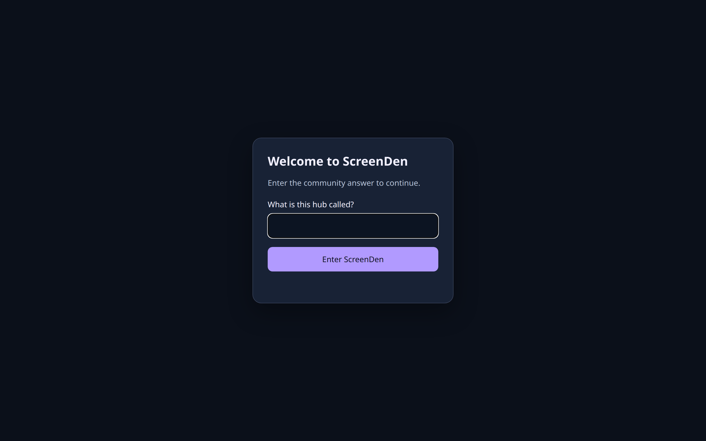
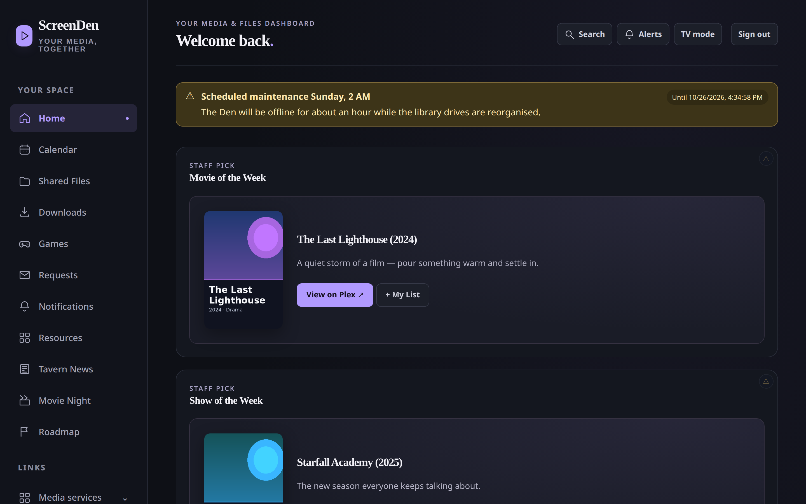
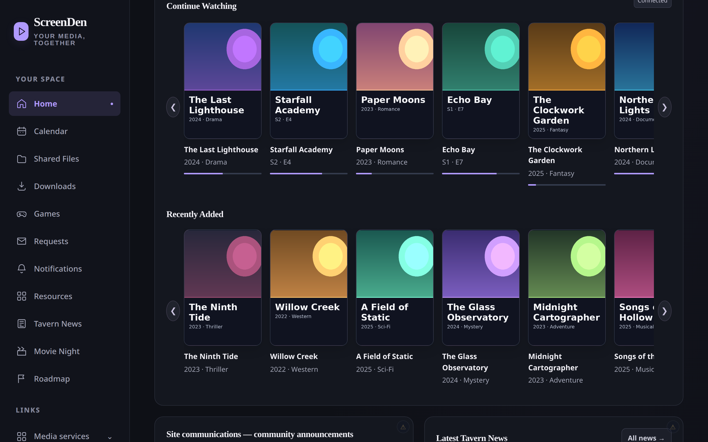
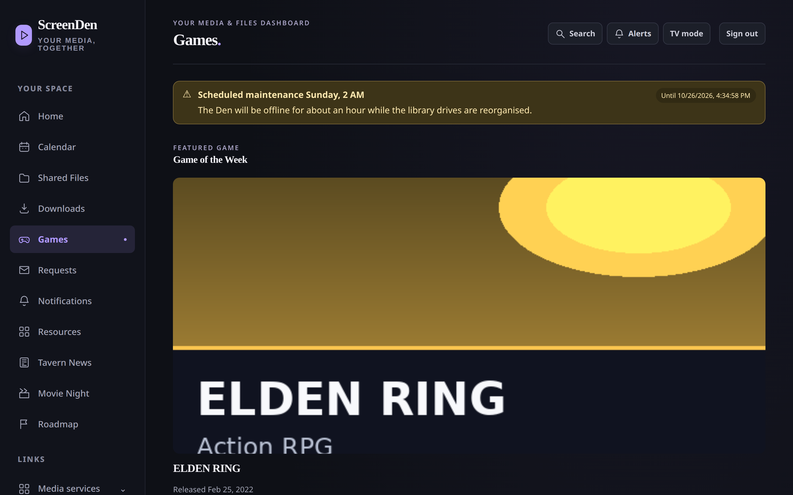
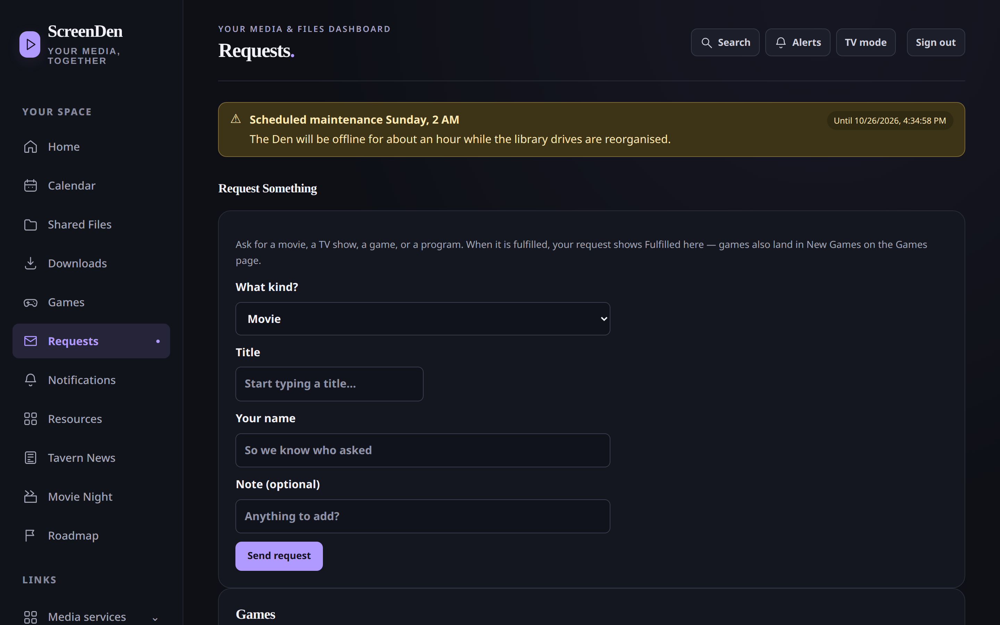
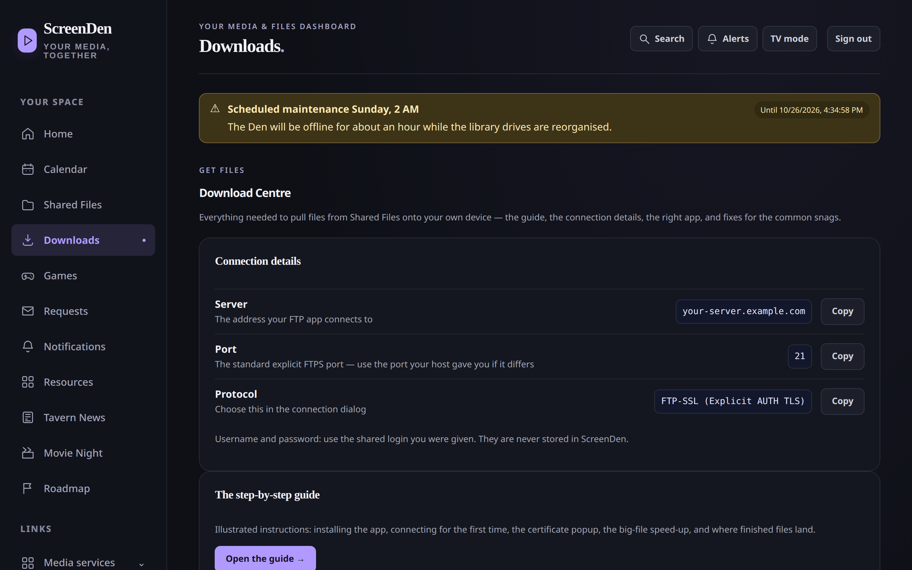
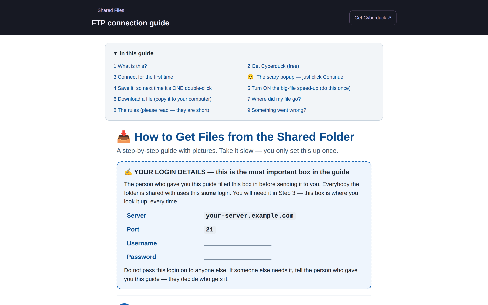
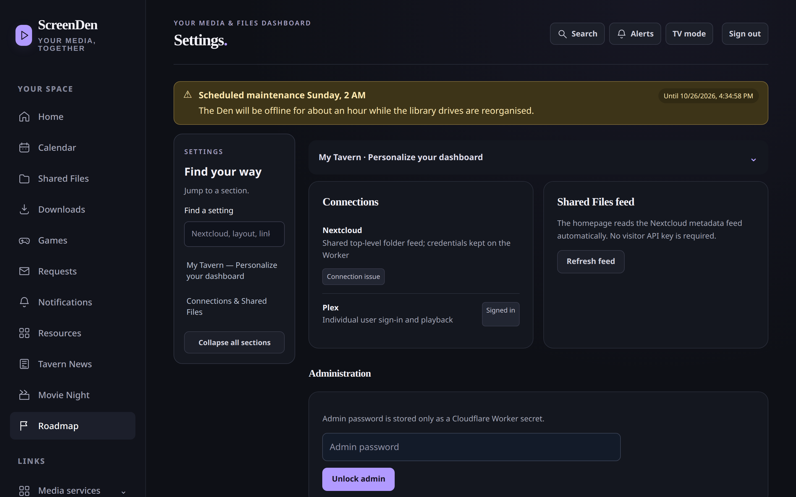
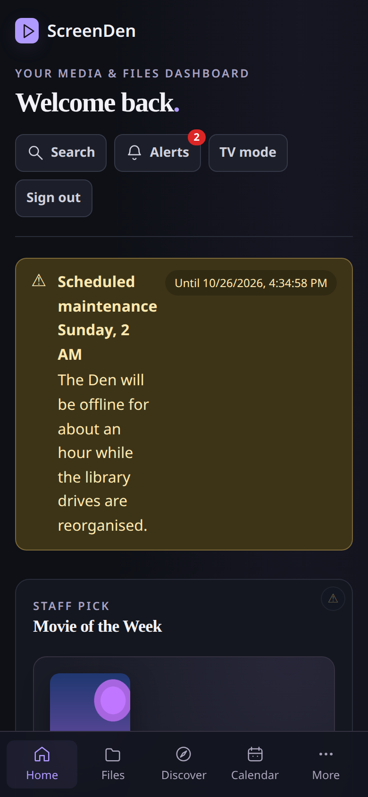

# ScreenDen

**A self-hosted, streaming-style homepage for your household** — one
Cloudflare Worker that puts your Plex library, your shared files and your
household's community life behind a single, friendly front door.

> **Status: 1.0.0-rc.1 — release candidate.** A complete, working build,
> published so it can be used and improved in the open. The setup walk
> below is the one the code expects; a first tagged 1.0.0 release follows.
> ScreenDen is a public edition of a private household hub, scrubbed of
> every private default: no server, address, name or contact is baked in.

## What it is

ScreenDen is the page your household actually opens. Members sign in with
Plex and get a Netflix-style home for the media they already have:
continue watching, new additions, weekly picks, a watchlist, and playful
ways to pick something (Surprise Me, Watch Roulette). Around that sits a
small community layer — news, announcements, a requests board, Movie
Night polls, problem reports — plus optional modules for shared files
(Nextcloud) and service status (Uptime Kuma) that stay completely dark
until an admin configures them.

Everything runs in **one Cloudflare Worker** with **one D1 database**
whose schema creates itself on first use. There is no build step, no
separate frontend hosting, and nothing phones home.

## Screenshots

From a local demo instance seeded with sample data — the titles and
poster art are fictional placeholders, and the connection details are
the public placeholders, so what you see is the real interface with
nothing private in it.

The community gate — every visitor answers one shared question:

Home, with the weekly staff picks and an announcement banner:

Continue Watching and Recently Added, straight from Plex:

Games — Game of the Week, staff picks, requests and coming soon:

One request form for movies, shows, games and programs:

The Download Centre — connection details with copy buttons (these
move to your own server details when an admin configures them):

The illustrated FTP guide members use to connect:

Settings — personalisation, connections and the admin area:

And the same home on a phone:

## Features

- **Plex, first-class** — plex.tv PIN sign-in with automatic server
  discovery (every published address is raced, the winner remembered),
  library browsing and search, playback handoff to Plex, Surprise Me
  (movies and TV), Watch Roulette, Show/Movie of the Week, curated
  Coming Soon, and a per-member **My List** watchlist.
- **Community** — news posts with server-side drafts and revisions,
  announcements with an optional auto-expiring maintenance banner, a
  requests board (movies, shows, games, programs) with one-click admin
  fulfilment, Movie Night voting, an in-app notification inbox with
  optional Discord alerts and Web Push, and a Report a Problem flow that
  always stores reports in-app and can also email them.
- **Games** — metadata search (Steam works keyless; TMDB, RAWG and IGDB
  are optional), Game of the Week, a curated Coming Soon rail, and a
  Nextcloud folder importer that publishes Recently Added Games after
  admin review.
- **Files (optional)** — a Nextcloud shared-files feed, a per-server
  file browser with favourites and search, and personal Nextcloud
  connections where each member authorises their own account
  (credentials encrypted at rest). Dark until configured.
- **Service status (optional)** — Uptime Kuma status page integration
  with an incident history archive (sampled by cron). Dark until
  configured.
- **Household touches** — a question-and-answer entry gate you control,
  themes and a branding icon library, a Downloads page with an FTP
  guide, a Roadmap page, diagnostics that report integration health
  without ever showing a secret, and full configuration backup/restore.

## Deploy

You need a Cloudflare account (the free tier is enough to try it) and,
for the good stuff, a Plex server whose owner signs in once.

### Path A — Wrangler (recommended)

1. Clone this repository and enter the folder.
2. Create the database:
   `npx wrangler d1 create screenden-db`
   Copy the `database_id` it prints.
3. Copy `wrangler.example.jsonc` to `wrangler.jsonc` and paste your
   `database_id` into it. (Your real `wrangler.jsonc` is git-ignored;
   never commit an account or database id.)
4. Set the required secrets:
   - `npx wrangler secret put ADMIN_PASSWORD` — the admin password you
     will sign in with.
   - `npx wrangler secret put GATE_SESSION_SECRET` — a random value of
     at least 32 characters, e.g. the output of `openssl rand -hex 32`.
   - `npx wrangler secret put METADATA_ENCRYPTION_KEY` — another random
     32+ character value; it encrypts any provider keys saved in the app.
     Keep a backup: losing it makes saved keys unreadable.
5. Deploy: `npx wrangler deploy`
   The template also registers a Cron Trigger (`*/5 * * * *`) used by
   the optional Uptime Kuma history sampler; it is harmless if you
   never configure Kuma.
6. Open the `workers.dev` URL Wrangler prints and do the first-run
   steps below.

### Path B — Cloudflare dashboard

1. **Create the database:** Workers & Pages → D1 → Create database,
   name it `screenden-db`.
2. **Create the Worker:** Workers & Pages → Create → Worker, name it
   `screenden`, and deploy the placeholder.
3. **Bind the database:** your Worker → Settings → Bindings → Add →
   D1 database, variable name exactly `DB`, database `screenden-db`.
4. **Add the secrets:** Settings → Variables and Secrets → add
   `ADMIN_PASSWORD`, `GATE_SESSION_SECRET` (32+ random characters) and
   `METADATA_ENCRYPTION_KEY` (32+ random characters), each as a Secret.
5. **Upload the code:** your Worker → Edit code → replace the editor
   contents with this repo's `worker.js` → Deploy.
6. **(Optional) Cron:** your Worker → Settings → Triggers → add a Cron
   Trigger `*/5 * * * *` if you want Uptime Kuma incident history.
7. Open your Worker's URL and do the first-run steps below.

### First run (both paths)

1. The entry gate asks **"What is this hub called?"** — the built-in
   starter answer is **`screenden`**. (It exists so a fresh install can
   be opened for the first time; it is printed here, in public, so treat
   it as public knowledge.)
2. Sign in as admin (Settings, using the `ADMIN_PASSWORD` you set) and
   **immediately set your own gate question and answer** in
   Settings → Administration (entry question) → Save Changes. From that
   moment the starter answer stops working.
3. Sign in with Plex and choose your server. That is the whole product
   for most households.
4. Turn on optional modules only if you want them — see
   [SETUP.md](SETUP.md).

### Updating

Replace `worker.js` (dashboard) or pull and `npx wrangler deploy` again.
Bindings, secrets, the D1 database and the Cron Trigger persist. The
schema upgrades itself. Back up first if you are cautious: Settings →
Administration can export a configuration backup in the app.

## Configuration reference

| Name | Kind | Needed for |
|---|---|---|
| `DB` | D1 binding | Everything (required) |
| `ADMIN_PASSWORD` | Secret | Admin sign-in (required) |
| `GATE_SESSION_SECRET` | Secret, 32+ chars | The entry gate (required) |
| `METADATA_ENCRYPTION_KEY` | Secret, 32+ chars | Saving provider keys in the app |
| `PLEX_SESSION_SECRET` | Secret, 32+ chars | Plex sessions (recommended; a fallback exists) |
| `NC_DAV_URL`, `NC_USER`, `NC_APP_PASSWORD` | Secrets | The shared Nextcloud files feed |
| `NC_LAB_ENCRYPTION_KEY` | Secret, 32+ chars | Personal Nextcloud connections |
| `KUMA_STATUS_URL` | Variable | Uptime Kuma status + history |
| `RESEND_API_KEY`, `REPORT_FROM_EMAIL`, `REPORT_TO_EMAIL` | Secrets | Emailing problem reports (see REPORT-EMAIL-SETUP.md) |
| `TMDB_API_KEY`, `RAWG_API_KEY`, `IGDB_CLIENT_ID`, `IGDB_ACCESS_TOKEN` | Secrets | Optional metadata providers (or save keys in the app instead) |
| `PLEX_CLIENT_ID` | Variable | Override the Plex client identifier (rarely needed) |
| `PREVIEW_API_KEY` | Secret | The admin preview API for Nextcloud pins (rarely needed) |

A fuller walkthrough of every optional module lives in
[SETUP.md](SETUP.md), with [KUMA-SCHEDULER-SETUP.md](KUMA-SCHEDULER-SETUP.md),
[METADATA-KEY-SETUP.md](METADATA-KEY-SETUP.md) and
[REPORT-EMAIL-SETUP.md](REPORT-EMAIL-SETUP.md) for the pieces that need
their own page.

## Development

- `worker.js` is the deployable artifact. `frontend.js`, `styles.css`
  and `discovery.js` are the standalone sources embedded in it — after
  editing them, re-embed and check parity:
  `node tools/build-embed.mjs worker.js styles.css frontend.js worker.js`
  then `node tools/check-embedded.mjs worker.js`. Never edit one copy
  alone.
- Tests are dependency-free Node scripts: `node test-<name>.mjs`, or run
  them all: `for t in test-*.mjs; do node $t || break; done`.
- Releases are scrub-gated: no personal strings in code, defaults, docs
  or tests. `tools/scrub-gate.py` runs the generic checks anywhere; the
  full release gate adds a private denylist that is deliberately not
  published.

## License

MIT — see [LICENSE](LICENSE).
